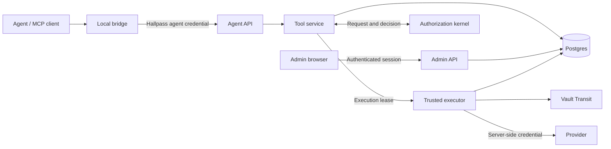

# Hallpass system design

Hallpass lets AI agents act on a user's behalf without holding provider credentials. A user connects a provider once and delegates specific actions, resources, and constraints to each agent. Hallpass authorizes each invocation and calls the provider with a server-side credential.

Consider an agent that can update a HubSpot deal's `dealstage` or `amount` with human approval. If the request also includes `dealname`, Hallpass denies the entire update. If the human approves the requested change, an identical retry can use that approval once, subject to current authority. Revoking the grant blocks later calls. The [HubSpot end-to-end test](../bridge/src/test/scala/run/hallpass/gateway/BridgeHubSpotEndToEndSuite.scala#L202) exercises this flow through the bridge, API, and database.

## Architecture

The agent and admin APIs are separate listeners in one deployable service. The bridge translates MCP calls to HTTP. Keeping authorization and execution in the same process lets them share typed interfaces and keeps the execution lease off the network. Postgres holds authority, approvals, audit records, and the locks that coordinate stateless API replicas. The pure kernel makes decisions from typed inputs supplied by the application. A provider integration registers operations in the same execution path, each with an explicit capability, argument decoder, resource resolver, and provider client.

## Authorizing one call

1. **Bind the request.** The API authenticates the agent and takes the tenant from verified identity. It decodes the arguments once, resolves the target from server-side resource records, and derives typed facts such as the fields being updated.
2. **Evaluate authority.** Effective authority is the intersection of the original grantor's current policy and every active delegation in the chain. Each link must cover the capability, resource, and facts. Deny takes precedence over approval, then allow. An unmatched request is denied. Every tool call is checked independently of tool discovery.
3. **Bind approval and execution.** An approval is tied to the agent, exact invocation, capability, and policy version. Only the human whose policy applies can approve it. On an identical retry, Hallpass reauthorizes the request and atomically consumes the approval. An allowed request issues a short-lived, single-use lease bound to the resolved invocation and executor. Issuance and redemption happen inside the same request on the same replica, so lease storage can be local.
4. **Revalidate and dispatch.** The executor redeems the lease, verifies the invocation binding, and takes the tenant gate. It checks current authority before and after obtaining the provider credential, since credential acquisition can outlast a grant. It dispatches using the same decoded input and resolved target.

The agent and its host are untrusted. A compromised host can exercise the agent's delegated authority until expiry or revocation. Tenant isolation is enforced by tenant-bound identity, forced Postgres row-level security, and composite foreign keys. Provider secrets are envelope-encrypted with tenant-bound keys. On the tool path, credential access requires a redeemed lease.

## Revocation and concurrent execution

A database check alone leaves a race between authorization and sending the provider request. Hallpass uses a per-tenant readers–writer gate. Executions hold a shared lock through dispatch and the audit attempt. Authority changes hold an exclusive lock through commit. Calls can run in parallel, and a queued revocation prevents new readers from entering ahead of it. Once the revocation commits, the next execution acquiring the gate sees the updated authority.

The production gate uses Postgres session-level advisory locks. A revocation can wait behind slow calls, and each holder occupies a database session. The executor confirms lock ownership immediately before dispatch and fails closed if it cannot. If the session is lost after that check, a request can still reach the provider. The provider does not check Hallpass lock ownership, and Hallpass cannot recall a request the provider has accepted. The [two-instance test](../gateway/src/test/scala/run/hallpass/gateway/TwoInstanceCanarySuite.scala#L185) covers cross-replica revocation and gate failure.

## Failure handling

| Failure | Behavior |
|---|---|
| Invalid authority or inability to establish it | Stop before dispatch. |
| Client disconnect during dispatch | In a live process, dispatch and the audit attempt can finish. |
| Ambiguous provider write or failed completion audit after dispatch | Return `outcome_unknown`. The bridge advises checking provider state before retrying. Hallpass does not automatically replay the write. |

Hallpass records lease redemption with the policy version and delegation chain before dispatch. A crash or database failure can leave that entry without a terminal outcome. The provider side effect and the audit write can fail independently. [Executor failure tests](../application/src/test/scala/run/hallpass/application/ProviderExecutionServiceSuite.scala#L560) cover audit failures.

## Scaling

The first capacity question is how many gate sessions the provider latency consumes. At 1,000 calls/s and an assumed mean gate hold time of 100 ms to 1 s, about 100–1,000 sessions would be occupied across replicas. The default gate pool is 16 per replica. These are illustrative inputs.

I would measure gate hold time, pool wait, and revocation latency under a hot tenant before changing the architecture. If contention dominates, I would cap per-tenant concurrency to protect shared capacity. If the primary becomes the limit across tenants, I would shard by tenant so authority, audit, and gate ownership stay on the same shard.
