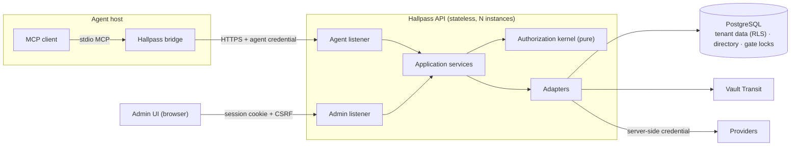
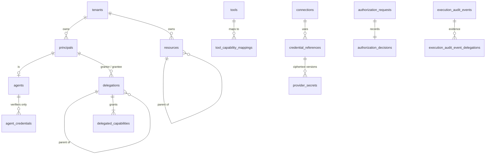
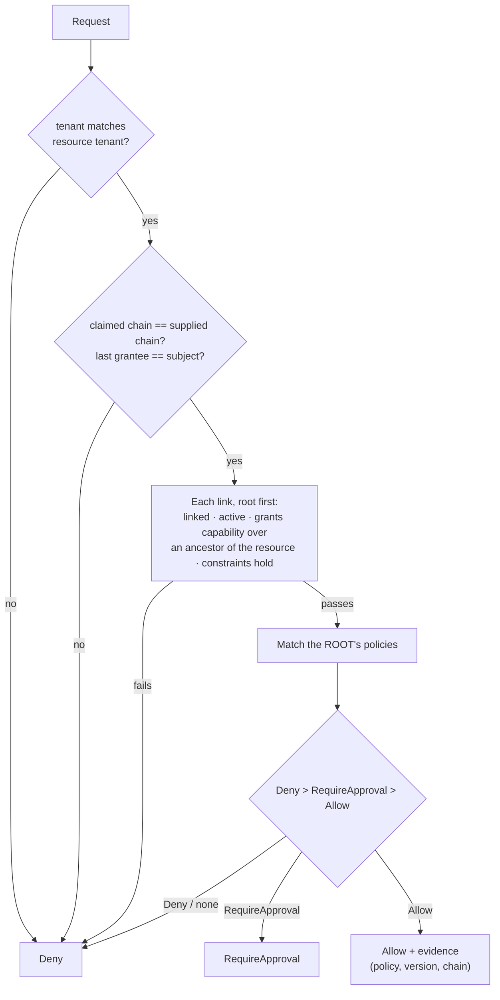
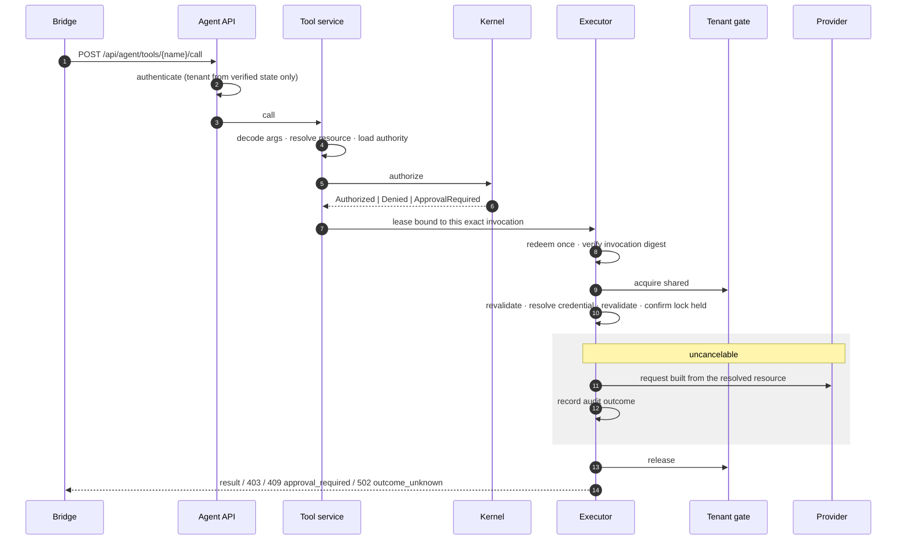
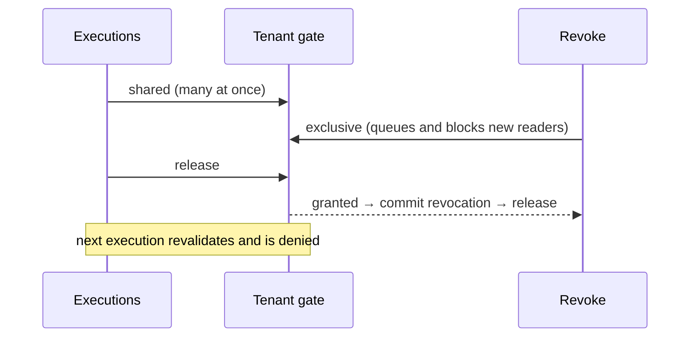
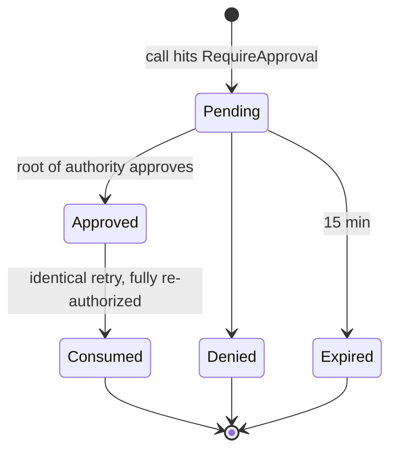

# Hallpass system design

Hallpass is an authorization and brokered-execution layer for AI agents. An agent never holds a provider credential.
It asks Hallpass to perform one operation; Hallpass checks that the agent's delegated authority covers that exact
operation, and only then does a trusted executor use a server-side credential to call the provider.

1. [Requirements](#1-requirements)
2. [Architecture](#2-architecture)
3. [Domain model](#3-domain-model)
4. [Authorization kernel](#4-authorization-kernel)
5. [Request lifecycle](#5-request-lifecycle)
6. [Revocation and the tenant gate](#6-revocation-and-the-tenant-gate)
7. [Isolation, secrets, and authentication](#7-isolation-secrets-and-authentication)
8. [Approvals](#8-approvals)
9. [Failure modes](#9-failure-modes)
10. [Scaling](#10-scaling)
11. [Trade-offs](#11-trade-offs)

---

## 1. Requirements

Today a developer who wants several agents (Claude Code, Codex CLI, an internal agent) to use their tools pastes a
broad token into each one. Every agent gets the token's full authority, nothing can be revoked per agent, and there is
no record of which agent did what.

**Functional**

- Connect a provider once (Slack, GitHub, Linear, Notion, Google Drive, Gmail, HubSpot).
- Give each agent its own credential and a subset of the human's authority, scoped to resources, actions, and
  constraints. Agents can re-delegate to subagents, but only with less authority.
- Each call is allowed, denied, or requires human approval; allowed calls run with a server-side credential.
- Grants expire and can be revoked. Every decision is explainable: who, through which agent, on whose authority, under
  which policy version.
- Independent of protocol (MCP today) and model vendor.

**Non-functional**

| Requirement | Mechanism |
|---|---|
| Fail closed | Typed decisions, never booleans; infrastructure errors are failures, not allows or denials |
| Revocation applies to the next call | Per-tenant readers–writer gate held through dispatch ([§6](#6-revocation-and-the-tenant-gate)) |
| Credentials never reach the agent, model, browser, logs, or traces | Credentials reachable only through a redeemed single-use lease; telemetry that cannot carry runtime strings |
| Tenant isolation, defense in depth | Typed IDs, composite foreign keys, forced row-level security, tenant-bound crypto |
| Horizontally scalable API | Stateless instances; shared state in Postgres |

**Threats considered:** prompt injection (controls tool names, arguments, timing), a compromised agent host (holds
one agent credential), another tenant, credential stuffing, and an insider with database read access. A provider that
has already accepted a request cannot be recalled, so revocation guarantees apply to calls that have not started.

---

## 2. Architecture



| Module | Role |
|---|---|
| `kernel` | Pure authorization: delegation chains, policy evaluation, unforgeable `AuthorizedCapability` and `ExecutionLease`. No I/O. |
| `application` | Orchestration and ports: tool pipeline, trusted executor, lease store, tenant gate, approvals. |
| `adapters` | Postgres (Doobie, Flyway, RLS), envelope secret store, OIDC, provider clients. |
| `gateway` | Composition root: HTTP (http4s), config, production guard, OpenTelemetry, operator CLIs. |
| `bridge` | stdio MCP adapter on the agent host. Holds only a Hallpass agent credential; no database, secret, or provider code. |

The build enforces the dependency direction `kernel ← application ← adapters ← gateway`. The agent and admin surfaces
are separate listeners so they can be exposed differently.

---

## 3. Domain model

| Concept | Meaning |
|---|---|
| Principal | `Human`, `Agent`, or `Service`. A model is execution context, not a principal. |
| Resource | Protocol-independent node in a tree (GitHub installation → repository). |
| Capability | Stable provider-neutral name plus action (`GitHub.Issue.Create` / `Write`). Tools map to capabilities explicitly; unmapped tools deny. |
| Policy | Versioned statements: subject, resource, actions, capability, constraints, effect (`Allow` / `RequireApproval` / `Deny`). |
| Delegation | Grantor → grantee, a non-empty capability set, constraints, validity window, optional parent, revocation time. |
| Constraint | Condition over typed facts from the call, e.g. `hubspot.properties ⊆ {dealstage, amount}`. |
| Connection | How Hallpass authenticates to a provider. Separate from what any agent may do with it. |
| Operation | Code-defined descriptor: tool, capability, action, argument decoder, resource locator, facts, provider client. |



Every tenant-owned table carries `tenant_id`, and every foreign key between them includes it, so a row cannot
reference another tenant's row even with a valid ID.

---

## 4. Authorization kernel

The kernel is a pure function: `policies + delegation chain + request + time → Allow | Deny | RequireApproval`.



- **Attenuation is structural.** Policy is evaluated for the root of the chain, and every link must itself grant the
  capability, so effective authority is the intersection of the root's policy and every link. A child grant cannot
  outlive its parent, and revoking a link invalidates everything below it on the next call.
- **The result cannot be forged.** `AuthorizedCapability` is an opaque type built only by the kernel. A lease can be
  issued only from one, and the credential port accepts only a redeemed lease:

```text
untrusted intent ─authorize→ AuthorizedCapability ─issue→ ExecutionLease ─redeem once→ RedeemedExecutionLease ─→ credential
```

---

## 5. Request lifecycle

Every provider operation goes through one pipeline. Adding a provider means registering operations, not adding an
execution path.



- **Arguments are parsed once.** The value decoded before authorization is the value dispatched. The request is built
  from the server-resolved resource, so the model cannot redirect a call through its arguments.
- **Leases are single-use, audience-bound, and bound to a digest of the exact invocation.** They are issued and redeemed
  in the same request on the same instance and never returned to the caller, so an in-memory store is correct with any
  number of instances.
- **Dispatch and its audit record are uncancelable together,** so a disconnect cannot leave an unaudited side effect.
- **Tool visibility is not the security boundary.** `tools/list` hides unusable tools to help the model; a hidden tool
  called directly is still denied.

---

## 6. Revocation and the tenant gate

**Invariant:** if a revocation commits before an execution's final revalidation, that execution never reaches the
provider.

A short database transaction can't provide this: the provider call happens outside it, so a check can pass, a
revocation commit, and the call still go out. Hallpass holds a per-tenant **readers–writer gate** from revalidation
through dispatch.



- Executions don't conflict with each other, so they share the gate. Authority changes are rare and human-initiated,
  so making them exclusive is cheap. A queued writer blocks new readers, so a revocation can't be starved. Tenants are
  independent.
- **Production implementation:** Postgres session-level advisory locks (`pg_advisory_lock_shared` / `pg_advisory_lock`)
  per tenant on a dedicated pool, with `lock_timeout`. Postgres releases a lock only when its session ends, so a
  partitioned holder could outlive its lock until keepalive detects it. The executor re-checks `pg_locks` on its own
  session immediately before dispatch, shrinking that window to milliseconds. A provider cannot be fenced, so the
  window is bounded, not zero.
- Any gate failure fails closed and is audited.

---

## 7. Isolation, secrets, and authentication

**Tenant isolation** is layered:

1. The tenant comes only from verified state (agent credential or browser session), never from a request body or header.
2. Opaque typed IDs; request contexts can be built only by authenticators.
3. The kernel denies if the request tenant differs from the resource tenant.
4. Every transaction sets `authai.tenant_id`; forced row-level security on every tenant table fails closed without it;
   composite `(tenant_id, id)` foreign keys.
5. The runtime database role is not the owner, has no `BYPASSRLS`, and has an explicit per-table grant matrix. Tests
   read the live catalog to check this.
6. Pre-tenant lookups (which tenant owns this credential? which user is this login?) go through narrow
   `SECURITY DEFINER` functions over a directory schema the runtime role cannot read directly.

**Secrets**

| Secret | Stored server-side as |
|---|---|
| Agent credential `ac1.<selector>.<secret>` | HMAC-SHA-256 verifier bound to the tenant; plaintext shown once |
| Browser session, login state, CSRF | Digests only |
| Provider credentials | AES-256-GCM, a fresh data key per secret, associated data = (tenant, connection, reference); data key wrapped by a tenant-derived Vault Transit key; insert-only rows |

A provider secret can be read only together with the connection it belongs to, and only by the executor after lease
redemption. GitHub App tokens are additionally minted per call for a single repository.

**Agent authentication** checks cheapest first, and each layer can only reject: a per-instance cache of permanently
invalid bearers (so a stale client can't use up its neighbours' budget) → per-address failure budget (429) → directory
route to the candidate tenant → durable cross-instance lockout → HMAC verification inside that tenant. A locked or
unknown credential gets the same 401. Human login is OIDC with PKCE; membership is rechecked on every request.

---

## 8. Approvals



An approval covers exactly one invocation (same principal, invocation digest, capability, and policy version). Only the
human whose policy is in force can decide; an agent can't approve its own request. The retry is authorized from
scratch, so a revocation in between still wins, and editing the policy invalidates outstanding approvals.

---

## 9. Failure modes

| Failure | Behavior |
|---|---|
| Unknown tool, unselected resource, missing fact | Deny |
| Revocation commits before final revalidation | Execution denied and audited |
| Database, gate, or key service unavailable | Request fails and is audited; no retries; never treated as allowed |
| Provider times out on a write | `502 outcome_unknown`, recorded as unknown, never retried; the bridge tells the model not to retry |
| Client disconnects during dispatch | Dispatch and audit still complete |
| Production mode with a dev-only component configured | Process refuses to start |

Every decision and execution step is written to append-only audit tables with the policy version and delegation chain,
and never contains credentials. Telemetry accepts only compile-time literal labels and typed IDs, so a secret can't
reach a span or metric.

---

## 10. Scaling

API instances are stateless: sessions, lockouts, approvals, and audit live in Postgres; leases never leave the request.

Rough estimate (not measured): a tool call costs about 5–10 small Postgres round trips plus the provider call, which
dominates latency at 100 ms–1 s. Kernel evaluation takes microseconds. At 1,000 calls/s, that is roughly 5–10k simple
queries/s, within one well-provisioned primary. **The binding constraint is gate connections:** each in-flight execution
holds a session for the provider call's duration, so 1,000 calls/s at 1 s means about 1,000 concurrent gate sessions.

How it would evolve:

1. **Gate.** Multiplex holds over fewer sessions, or move to a lock service with fencing tokens, behind the same port.
2. **Shard by tenant.** Every query is tenant-scoped and every key tenant-composite; the small directory routes tenants to
   clusters.
3. **Authority cache** keyed by a per-tenant version that every mutation bumps under the exclusive gate. Final
   revalidation still checks the version, so a stale cache can only cause a reload or a denial.
4. **Audit.** Time-partition, then stream execution events to a log for analytics; keep decisions synchronous.

---

## 11. Trade-offs

| Decision | Alternative | Why |
|---|---|---|
| Custom pure kernel | OPA, Cedar, Zanzibar-style ReBAC | Delegation attenuation, custody, invocation-bound approvals, and constraints on typed input are the core of the product; a pure typed function makes them property-testable. |
| Brokered execution | Give the agent a scoped token | Most providers can't issue tokens as narrow as a grant (one repo, two fields, named recipients). Cost: Hallpass is on the data path. |
| Gate held through dispatch | Short transaction; cache with a TTL | The only way to guarantee "revoked means the next call can't start". Cost: a revocation waits for in-flight calls in that tenant. |
| Postgres advisory locks | Redlock, etcd | Already a dependency; ownership is checkable in `pg_locks`. Redlock has no fencing; etcd adds operational weight. |
| Modular monolith | Microservices | One process on the critical path; the build enforces module boundaries, so services can be split out along them later. |
| Fail closed on unknown write outcome | Retry with idempotency keys | Not every provider supports them; Linear issue creation does and uses one. |

**Testing:** ScalaCheck properties on the kernel (each starts from an authorized baseline so it can't pass vacuously),
Postgres integration tests for row-level security and tenant isolation, a two-instance revocation test, and end-to-end
tests that run the real bridge, API, and database against fake providers.
